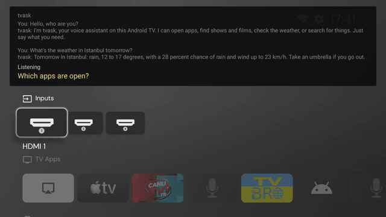
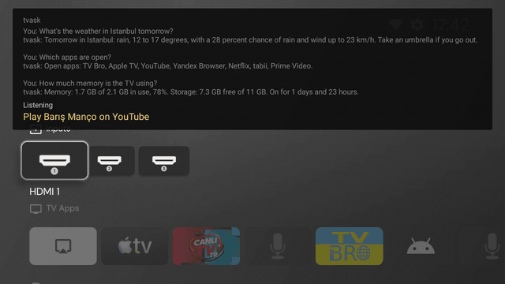
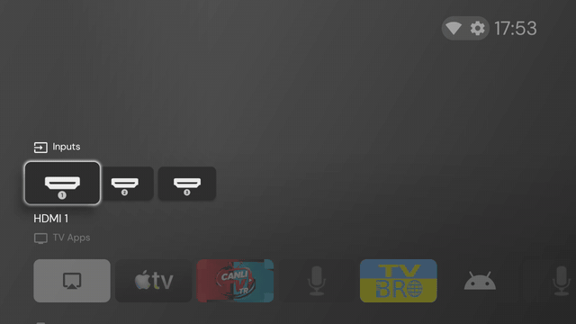
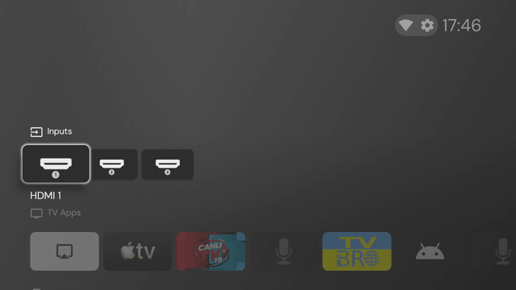

# tvask

Ask your Android TV in your own words.
tvask takes over the mic key on your remote and sends what you say to an AI model you choose.

Every TV is a little different.
So tvask is not an app you install and forget.
You set it up together with your own AI coding agent, which checks your TV and adapts the setup to it.

Site: https://urtuba.github.io/tvask/

## See it

Recorded on a TCL Google TV.

| | |
|---|---|
|  |  |
| "What's the weather in Istanbul tomorrow?" | "Which apps are open?" |
|  |  |
| "Play Barış Manço on YouTube" | "Show me some news sites in English", then the remote picks one |
|  | |
| "How much memory is the TV using?" | |

## What it does

- Answers questions, in the language you speak, and searches the web when it needs to.
- Opens apps and searches inside YouTube, YouTube Music, Prime Video and the browser.
- Gives the weather, reads web pages, and checks whether a site works.
- Lists and closes open apps, and shows memory, storage and uptime.
- Shows cards: weather, site options to pick with OK, match scores, open apps, system status.
- Keeps the conversation for five minutes, so follow-up questions work.
- Keeps notes about you in a small memory on the TV, like your city or team.
- Knows what is playing and what the app in front shows, if you allow it.
  It never looks at the screen image.

## Set it up with your agent

You need:

- Android TV or Google TV with Android 11 or newer, with the Google app for Android TV (`com.google.android.katniss`).
- A voice remote paired over Bluetooth. An IR-only remote sends no audio.
- A computer and an AI coding agent that can run shell commands. The agent installs adb if it is missing.
- An API key for an OpenAI compatible chat model. The default is DeepSeek.
- A Brave Search API key.

On the TV, turn on Developer options and USB debugging.
On Google TV: Settings, System, About, then press OK on "Android TV OS build" seven times.
USB debugging is then under Settings, System, Developer options.

Give your agent this prompt, with your TV's brand and model:

```
Set up tvask on my TV, a <brand and model>.
It is on my Wi-Fi. Follow
https://raw.githubusercontent.com/urtuba/tvask/main/AGENTS.md
and show me each command before you run it.
```

You don't need the TV's IP address. The agent finds the TV on your network.
[AGENTS.md](AGENTS.md) walks it through checks, install, vendor quirks, keys and a test.
You can also follow it by hand.

An agent with adb access has shell rights on your TV.
Read what it runs before you allow it.

## Your TV is different: fork it

If your TV needs code changes, fork this repository and keep those changes in your fork.
Search links, panel behavior and the model's tools are each in one file, see AGENTS.md.
Send back fixes that help every TV as a pull request, and tell us about your TV in an issue.

## Tune up the TV

The same agent can fix what makes Android TVs annoying.
[TUNEUP.md](TUNEUP.md) has short guides for a slow TV, a heavy home screen, remote keys that do nothing, and showing an iPhone on the TV.
All of them worked on the tested TCL.
Tell your agent the problem and point it to the part:

```
My Android TV feels slow.
Follow "The TV feels slow" in
https://raw.githubusercontent.com/urtuba/tvask/main/TUNEUP.md
and ask me before every change.
```

## How it works

1. You press the mic key. Android opens tvask, because tvask is the default assistant.
2. tvask asks Google's speech recognizer on the TV for the words.
   Only Google's remote service can read the remote's audio, so tvask does not record it itself.
3. tvask sends the recognizer's top five guesses to the model, with its tools.
   The guesses help the model fix words the recognizer got wrong.
   When you ask about what is playing or on screen, the model asks for the TV context.
4. The model answers or calls tools. tvask shows the answer, reads it aloud, and draws a card.
   For an app or a page, it says what it opens and fades out.

After a short pause tvask keeps listening, so you can go on.
Some tools answer from the TV itself, like open apps and system status, so the model is called only once.
Netflix opens, but it ignored search and title links on the tested TV, so tvask asks you to search with the remote.

## Settings

Open tvask from the app list, or say "open tvask settings".
The settings screen changes the reading speed, the wait after a pause, the browser, the screen language, the memory size, and whether tvask may use what is playing and on screen.
API keys stay with adb.

Every setting can also be set over adb, see AGENTS.md.
An empty value goes back to the default.

| Name | Default | Meaning |
|---|---|---|
| `chat_key` | none | API key of the chat model provider |
| `brave_key` | none | Brave Search API key |
| `chat_url` | `https://api.deepseek.com` | Base URL of an OpenAI compatible API. Changing it clears `chat_key`, so set the URL first. |
| `chat_model` | `deepseek-flash` | Model name |
| `chat_effort` | `low` | Sent as `reasoning_effort`. Low keeps answers fast. Empty sends nothing. |
| `browser` | first browser found | Package name of the browser, for example `com.phlox.tvwebbrowser` |
| `speech_rate` | `1.25` | Reading speed. 1 is the voice's normal speed. |
| `listen_more` | `2000` | Milliseconds to wait for more speech after a pause. 0 turns it off. |
| `ui_language` | TV language | Language of tvask's own texts, for example `en` or `tr`. Answers follow the language you speak. |
| `memory_size` | `1048576` | Bytes for memory notes. 0 turns memory off. |
| `tv_context` | `on` | `off` stops tvask from reading what is playing and the app in front. |

The keys live in the app's private storage on the TV.
Only adb can set them, because the receiver needs the `DUMP` permission.
They never go into the APK.

Weather comes from [Open-Meteo](https://open-meteo.com), which needs no key and is free for non-commercial use.
We use [TV Bro](https://github.com/truefedex/tv-bro) as the browser. Any browser that opens web links works.

## Privacy

- Your voice goes to Google, through Google's speech recognizer.
- The recognized text, your installed app list, the date and your memory notes go to the chat model provider.
- The TV context is what is playing and the text of the app in front.
  tvask reads it when you press the mic key, and sends it only when the model asks for it.
  It skips the home screen and the screen saver, never uses screenshots, and the log keeps only its size.
  Turn it off with `tv_context`.
- Web search queries go to Brave. Place names for the weather go to Open-Meteo.
- Pages the model reads or checks see a request from your TV.
- tvask keeps a log of what it heard and did on the TV, see Debugging.
  Memory notes stay in the app's private storage. Clear them in the settings.

## Security

Web pages, search results and screen text can contain instructions meant for the model.
tvask marks that text as data and tells the model not to follow it.
Once such text is in a turn, tvask removes the tools that close apps or change memory for the rest of that turn.
Pages are read only from sites you named, saw, or got from the same turn's search.
This lowers the risk. It does not remove it.

## Go back to Google Assistant

See Undo at the end of [AGENTS.md](AGENTS.md).

## Debugging

```
adb shell cat /sdcard/Android/data/io.github.urtuba.tvask/files/transcripts.txt
adb logcat -s tvask
```

## Known quirks

- The recognizer works in one language: the TV's language.
  Words from another language in the same sentence often come out wrong.
- When tvask is the assistant, Google's remote service switches the remote to its legacy voice mode.
  In that mode the remote's audio reaches Google's recognizer through the normal recording path.
- An app counts as open if it was used in the last three hours.
  Android does not show other apps' processes to a normal app, so there is no memory or CPU use per app.
  Closing goes to the home screen first, because Android only stops apps in the background.
- TV Bro may show "Can not link to WebView component" when it starts and restores many tabs on a low memory TV.
  The page still loads behind the message. Closing old tabs in TV Bro helps.
- TCL: the window manager sends "close system dialogs" on key presses. tvask ignores it.
- TCL: the memory cleaner may stop tvask while it is idle. Android starts it again on the next key press.

Tested on: TCL 50P735 with the RC902V remote.

## Build

Needs JDK 17 and the Android SDK packages `platforms;android-30` and `build-tools;34.0.0`.

```
./build.sh
```

This makes a debug build in `build/tvask.apk`.
See the top of `build.sh` for a release build.

## License

MIT. See `LICENSE`.
